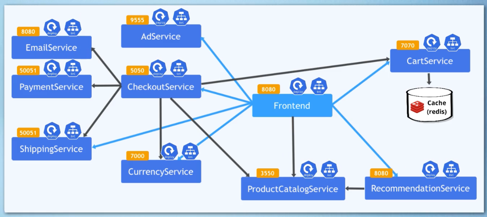
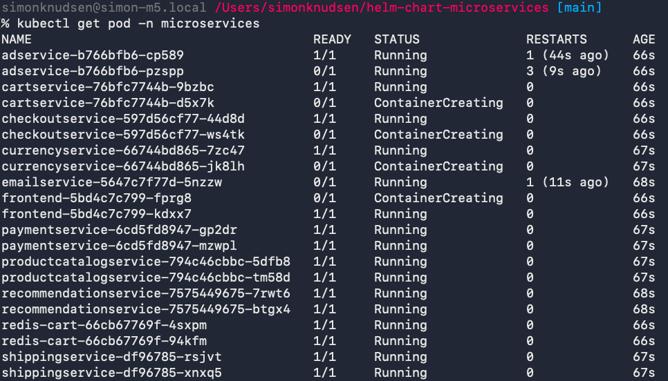
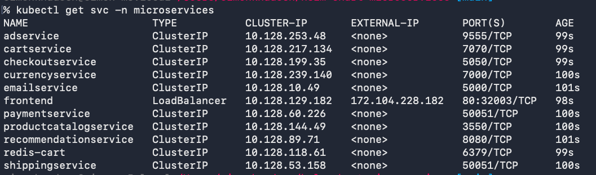

## Demo Project:
Deploy Microservices application in Kubernetes with Production & Security Best Practices

## Technologies used:
Kubernetes, Redis, Linux, Linode LKE

## Project Description:
- Create K8s manifests for Deployments and Services for all microservices of an online shop application
- Deploy microservices to Linode's managed Kubernetes cluster

*Module 10: Container Orchestration with Kubernetes*

---

## How it works

The online shop (Online Boutique) is split into 11 microservices that talk to each other over gRPC. Each microservice has its own Kubernetes **Deployment** and **Service**, and the shopping cart stores its data in a **Redis** cache. Only the frontend is exposed to the internet, through a LoadBalancer. All other services are internal (ClusterIP) and can only be reached from inside the cluster.

*Architecture overview: every microservice runs as its own Deployment with a Service in front of it, labelled with its container port. The Frontend calls the backend services, CheckoutService handles orders through Payment, Shipping, Email and Currency, and CartService stores carts in Redis.*

 

*`kubectl get pod -n microservices`: all microservices running as pods in the `microservices` namespace on the Linode LKE cluster. Each Deployment runs 2 replicas, so the shop stays available if a pod or node fails.*

 

*`kubectl get svc -n microservices`: one Service per microservice. The backend services and `redis-cart` are `ClusterIP` (internal only), while `frontend` is a `LoadBalancer` that Linode gives a public external IP.*

 

*Result: the Online Boutique shop running on Linode LKE, opened in the browser through the frontend LoadBalancer's external IP.*

## Production & Security Best Practices applied
- Liveness and readiness probes on every container
- CPU and memory resource requests and limits
- Multiple replicas per Deployment for high availability
- Only the frontend is exposed externally; all other services stay internal
- Containers run as non-root
